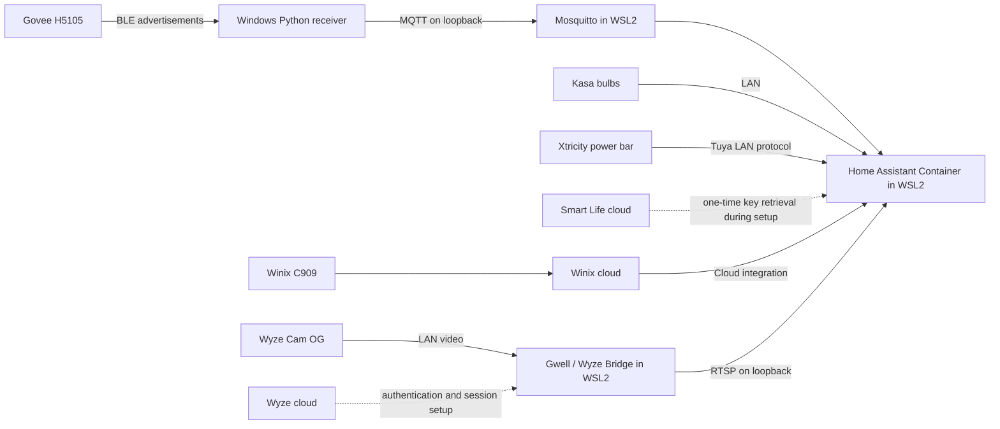

# Home Assistant on Windows with local devices

A tested Windows + WSL2 setup for Home Assistant Container, a Govee H5105 Bluetooth sensor, Kasa bulbs, an Xtricity Smart Life power bar, a Winix C909 purifier, and an experimental Wyze Cam OG LAN video bridge. Includes reusable receiver and startup scripts, sanitized configuration examples, and the limits observed during testing.

This project assembles existing open-source integrations. The Bluetooth decoder and Wyze protocols belong to their upstream projects; see [credits](docs/credits.md).

## Tested devices and cloud dependencies

| Device / component | Tested behavior | Internet dependency |
| --- | --- | --- |
| Govee H5105 | Windows BLE advertisements → local MQTT → Home Assistant sensors | No Govee account or cloud used for readings |
| Kasa KL125 bulbs | Home Assistant TP-Link integration, direct device connection | Third-Party Compatibility was enabled in the vendor app during setup; no outage test was performed |
| Xtricity Smart Life power bar | Tuya Local 2026.9.2, three switch channels and three timers; switch test and Home Assistant restart succeeded | Smart Life QR sign-in retrieved the local key during setup; runtime control uses LAN. No internet-blocking test was performed |
| Winix C909 | Winix custom integration 1.7.0; fan, air-quality and filter-life entities | Winix cloud account and internet required; this is a cloud-dependent exception |
| Wyze Cam OG, firmware 1.0.98 | Gwell LAN video → local RTSP → Home Assistant Generic Camera | Cloud authentication/session setup still required in the tested bridge |

**The Wyze camera is not established to be fully offline.** An existing stream continued while the bridge's internet access was blocked, but restarting the Gwell sidecar failed on a cloud token request. The camera's own internet access was not blocked. These were short tests on one camera and one sensor, not a long-term reliability study.

## Architecture



Windows keeps ownership of its Bluetooth adapter. The sensor receiver does not pair with the sensor or pass the adapter into WSL, so the same adapter can continue serving a keyboard, mouse and headphones.

## Start here

1. Read [Windows and Home Assistant setup](docs/windows-setup.md).
2. Follow [Govee H5105 setup](docs/govee-h5105.md) for local sensor readings.
3. Optionally follow [Wyze Cam OG setup and limitations](docs/wyze-cam-og.md).
4. Follow [Xtricity power bar local setup](docs/xtricity-smart-life.md).
5. Optionally follow [Winix C909 cloud setup](docs/winix-c909.md).
6. See [tested findings](docs/findings.md), [privacy](docs/privacy.md), and [credits](docs/credits.md).

The [sanitized Xtricity upstream report](docs/upstream/xtricity-tuya-local-report.md) is ready for submission when Tuya Local accepts contributions again. It has not been submitted upstream; its status note records the restrictions observed when submission was attempted.

Use these files in a separate installation. The Compose project names are deliberately different from an existing installation, but both installations use the same service ports. Stop an existing stack or choose separate ports before starting another one. The scripts never migrate an existing Home Assistant configuration.

## Validation

The installed configuration was verified with live sensor readings, MQTT discovery in Home Assistant, camera playback in the browser, and stop/start of the sensor receiver. The Xtricity bar passed a brief switch test and reconnected locally after a Home Assistant restart. Winix entity availability and dashboard persistence were verified; no purifier power-change test was performed. The generalized scripts here additionally have configuration/discovery tests and syntax checks. Their new scheduler-registration implementation has not been registered as a second live task on the original PC.

```powershell
.\govee\.venv\Scripts\python.exe -m unittest discover -s tests -v
```

Pinned versions describe the tested environment; review upstream changes before upgrading. The original scripts in this repository are MIT licensed. Referenced dependencies and container images retain their own licenses.
